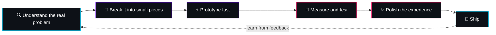

<!-- ================= HEADER ================= -->
<p align="center">
  
</p>

<p align="center">
  <a href="https://ahzam-portfolio.netlify.app">
    
  </a>
</p>

<p align="center">
  
  
  
</p>

<p align="center">
  <a href="https://ahzam-portfolio.netlify.app"></a>
  <a href="https://linkedin.com/in/YOUR_LINKEDIN"></a>
  <a href="mailto:YOUR_EMAIL"></a>
</p>

---

## 👨‍💻 About Me

> *"Good software is a conversation: the user asks, the interface answers, and it feels effortless."*

I'm a **YOUR_TITLE** based in **Pakistan 🇵🇰**. I love building interfaces that look great **and** solve a real problem. My [portfolio](https://ahzam-portfolio.netlify.app) is itself an interactive experience, because I believe a portfolio should *show* skill instead of just listing it.

```js
const ahzam = {
  role: "YOUR_TITLE",
  focus: ["Interactive UI", "Motion & Animation", "Performance", "Clean Architecture"],
  mindset: "Understand the problem first. Then write the code.",
  currentlyLearning: ["YOUR_TOPIC_1", "YOUR_TOPIC_2"],
  funFact: "YOUR_FUN_FACT",
  lookingFor: "Projects where creativity meets real impact",
};
```

---

## 🧠 How I Solve Problems

Every project I take on goes through the same loop:



### 🧩 Problem → Approach → Result

| 🎯 Problem | 🛠 My Approach | ✅ Result |
|---|---|---|
| *YOUR_PROBLEM_1 (e.g. slow page load with heavy animations)* | *e.g. lazy loading, code splitting, optimized assets* | *e.g. load time reduced by X%* |
| *YOUR_PROBLEM_2 (e.g. complex state across many components)* | *e.g. structured state management and reusable hooks* | *e.g. cleaner code, fewer bugs* |
| *YOUR_PROBLEM_3 (e.g. site looked broken on small screens)* | *e.g. mobile-first redesign with fluid layouts* | *e.g. fully responsive on all devices* |

> 💡 Fill this table with your **real** challenges. Recruiters love seeing *how* you think, not only *what* you built.

---

## 🛠 Tech Stack

### Frontend


### Motion & Creative *(keep only what you really use)*


### Tools & Deployment


---

## 🚀 Featured Projects

<table>
<tr>
<td width="33%" valign="top">

### 🌐 [Interactive Portfolio](https://ahzam-portfolio.netlify.app)
My personal portfolio, built as an interactive experience instead of a plain page.

`YOUR_TECH` `YOUR_TECH` `YOUR_TECH`

[](https://ahzam-portfolio.netlify.app)

</td>
<td width="33%" valign="top">

### 📦 YOUR_PROJECT_2
One line: what problem does it solve?

`YOUR_TECH` `YOUR_TECH`

[](https://github.com/YOUR_GITHUB_USERNAME/YOUR_REPO)

</td>
<td width="33%" valign="top">

### 📦 YOUR_PROJECT_3
One line: what problem does it solve?

`YOUR_TECH` `YOUR_TECH`

[](https://github.com/YOUR_GITHUB_USERNAME/YOUR_REPO)

</td>
</tr>
</table>

---

## ⚙️ My Working Principles

| Principle | What it means |
|---|---|
| **Problem first, code second** | I make sure I understand *why* before deciding *how* |
| **Motion with purpose** | Animation should guide the user, never distract |
| **Performance matters** | A beautiful site that loads slowly is a failed site |
| **Clean, reusable code** | Components and structure that others can read easily |
| **Always learning** | Every bug is a lesson, every project is practice |

---

## 📊 GitHub Stats

<p align="center">
  
  
</p>

<p align="center">
  
</p>

---

## 🤝 Let's Build Something Together

Have an idea, a bug that won't die, or a project that needs a creative touch? Let's talk.

<p align="center">
  <a href="https://ahzam-portfolio.netlify.app"></a>
  <a href="mailto:YOUR_EMAIL"></a>
  <a href="https://linkedin.com/in/YOUR_LINKEDIN"></a>
</p>

<!-- ================= FOOTER ================= -->
<p align="center">
  
</p>
